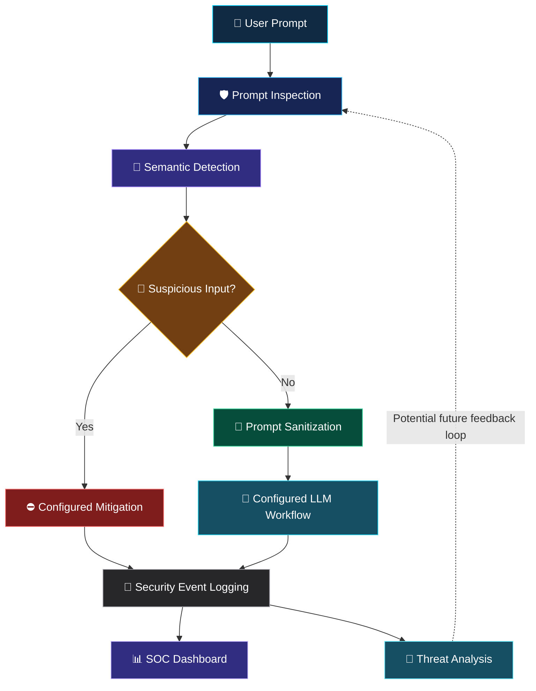

<div align="center">

<!-- Animated Header -->


<br>

<!-- Typing Animation -->
<a href="https://github.com/mohamedrizwan4518/An-adaptive-self-healing-semantic-ai-firewall-framework-v1-phase-1-">

</a>

<br><br>

<!-- Project Badges -->


<br>


<br><br>

### 🛡️ Intelligent Defence for Large Language Models

*A semantic AI firewall framework designed to detect and help mitigate prompt-based attacks through layered security mechanisms.*

<br>

<a href="#-about-the-project">

</a>
<a href="#-getting-started">

</a>

</div>

---

<div align="center">

## ⚡ THE MISSION

### Detect threats. Protect AI. Build trust.

</div>

As Large Language Models (LLMs) become increasingly useful, they also face security risks such as prompt injection, malicious instructions, and attempts to bypass model safeguards.

**Aegis AI** explores an adaptive, self-healing semantic firewall approach for identifying suspicious prompts and supporting security-focused monitoring.

The project combines prompt detection, semantic analysis, sanitization, threat tracking, and a Security Operations Center (SOC)-style dashboard in a single application.

> **Our vision:** Make AI interactions safer through intelligent detection, transparent monitoring, and adaptable security mechanisms.

---

## 📑 Navigation

| Section | Description |
|:---|:---|
| 🎯 [Project Overview](#-about-the-project) | The problem and our approach |
| ✨ [Key Features](#-key-features) | Security and monitoring capabilities |
| 🏗️ [Architecture](#️-system-architecture) | How the components are organized |
| 🖥️ [Screenshots](#️-application-preview) | Visual application preview |
| 🧰 [Technology Stack](#-technology-stack) | Tools and technologies |
| 🚀 [Installation](#-getting-started) | Run the application locally |
| 🧪 [Testing](#-testing) | Run the available tests |
| 🔐 [Security](#-security-considerations) | Current limitations and safe use |
| 🗺️ [Roadmap](#-future-roadmap) | Potential future improvements |
| 👥 [Team](#-project-team) | Project contributors |

---

## 🎯 About the Project

### Research Title

**An Adaptive Self-Healing Semantic AI Firewall Framework for Real-Time Detection and Mitigation of Prompt-Based Attacks in Large Language Models**

### The Problem

Traditional application security measures do not automatically address every risk introduced by natural-language interactions with AI systems.

A malicious or manipulated prompt may attempt to:

- Override the intended instructions of an AI application.
- Bypass established safety restrictions.
- Manipulate model behaviour through deceptive language.
- Introduce instructions that conflict with the original task.
- Exploit weaknesses in how an application processes user input.

### Our Approach

Aegis AI is designed around a layered security workflow that brings together prompt inspection, semantic analysis, sanitization, threat-related components, and dashboard monitoring.

The framework aims to provide a foundation for detecting suspicious input and making security events easier to inspect.

<div align="center">

| 🧠 Semantic Analysis | 🛡️ Threat Detection | 📊 Security Monitoring |
|:---:|:---:|:---:|
| Examine prompt meaning | Identify suspicious input | Present security information |
| Support threat classification | Apply configured detection logic | Review activity through a dashboard |

</div>

---

## ✨ Key Features

<table>
<tr>
<td width="50%" valign="top">

### 🧠 Semantic Detection

Designed to examine the meaning of incoming prompts and support the identification of suspicious instructions.

### 🧹 Prompt Sanitization

Includes a sanitization component intended to help handle potentially unsafe prompt content.

### 🚨 Threat Monitoring

Includes threat-related components for processing and tracking security events.

</td>
<td width="50%" valign="top">

### 📊 SOC Dashboard

Provides a security-focused interface for viewing available monitoring and analytics information.

### 📝 Attack Logging

Includes an attack-logging component for recording relevant security events.

### 💬 Chat Interface

Provides a user-facing interface for interacting with the application's configured AI workflow.

</td>
</tr>
</table>

> **Implementation note:** These features describe the project's intended components and application structure. Their actual effectiveness depends on the implementation, configuration, and testing performed.

---

## 🏗️ System Architecture

The following diagram illustrates the **conceptual workflow** of Aegis AI. It is not a claim that every component has been independently validated in a production environment.



### Security Workflow

1. **Input:** A user submits a prompt through the application.
2. **Inspection:** The configured security components inspect the prompt.
3. **Detection:** The detection logic evaluates whether the input appears suspicious.
4. **Handling:** The application follows its configured handling or mitigation path.
5. **Monitoring:** Relevant activity can be presented through the available logging and dashboard components.

The exact behaviour depends on the implemented detection rules, backend logic, and configured LLM integration.

---

## 🖥️ Application Preview

The repository includes the following application screenshots.

<div align="center">

### 📊 SOC Dashboard


*Security monitoring interface.*

<br>

### 🔬 Testing Lab


*Testing interface and displayed processing workflow.*

<br>

### 🔐 Login Interface


*Application login interface.*

<br>

### 💬 User Chat Interface


*User-facing chat interface.*

</div>

---

## 🧰 Technology Stack

<div align="center">

| Technology | Purpose |
|:---|:---|
|  | Application and security logic |
|  | Interactive user interface |
|  | Configured language-model workflow |
|  | Version control and source hosting |
|  | Project documentation |

</div>

The repository also contains dedicated modules for prompt detection, semantic detection, sanitization, threat tracking, authentication, analytics, and logging.

---

## 📂 Project Structure

```text
Aegis-AI-Phase1-Version1/
│
├── .streamlit/
│   └── config.toml
│
├── assets/
│   └── screenshots/
│       ├── soc_dashboard_overview.png
│       ├── testing_lab_pipeline_full.png
│       ├── login_screen.png
│       └── user_chat_view.png
│
├── backend/
│   ├── attack_logger.py
│   ├── auth.py
│   ├── blacklist_manager.py
│   ├── dashboard_analytics.py
│   ├── llm_engine.py
│   ├── main.py
│   ├── runner.py
│   ├── threat_engine.py
│   ├── threat_intelligence.py
│   └── user_manager.py
│
├── data/
├── experiments/
│
├── frontend/
│   └── app.py
│
├── security/
│   ├── prompt_detector.py
│   ├── prompt_sanitizer.py
│   ├── semantic_detector.py
│   └── threat_memory.py
│
├── tests/
│   └── test_aegis.py
│
├── .env.example
├── .gitignore
├── LICENSE
├── README.md
├── requirements.txt
├── run.bat
├── run.ps1
└── streamlit_app.py
```

---

## 🚀 Getting Started

Follow these steps to run Aegis AI on your local machine.

### Prerequisites

Install the following before starting:

- Python compatible with the project's dependencies.
- Git.
- A terminal such as PowerShell, Command Prompt, or Bash.

### Step 1 — Clone the Repository

```bash
git clone https://github.com/mohamedrizwan4518/An-adaptive-self-healing-semantic-ai-firewall-framework-v1-phase-1-.git
```

Move into the project directory:

```bash
cd An-adaptive-self-healing-semantic-ai-firewall-framework-v1-phase-1-
```

### Step 2 — Create a Virtual Environment

**Windows:**

```powershell
python -m venv .venv
.venv\Scripts\Activate.ps1
```

If you are using Command Prompt instead of PowerShell:

```bat
.venv\Scripts\activate.bat
```

**Linux or macOS:**

```bash
python3 -m venv .venv
source .venv/bin/activate
```

### Step 3 — Install Dependencies

```bash
python -m pip install --upgrade pip
pip install -r requirements.txt
```

### Step 4 — Configure Environment Variables

If your configured model provider or another component requires environment variables:

1. Open `.env.example`.
2. Review the required configuration values.
3. Create a local `.env` file if the application expects one.
4. Add your own valid credentials and configuration.

**Never commit API keys, passwords, access tokens, or other secrets to GitHub.**

Do not add credentials unless they are required by your configured implementation.

### Step 5 — Launch the Application

Try the main Streamlit entry point:

```bash
streamlit run streamlit_app.py
```

If your project is configured to use the frontend entry point instead, run:

```bash
streamlit run frontend/app.py
```

Use the entry point appropriate for your implementation.

Streamlit normally displays a local address in the terminal, such as:

```text
http://localhost:8501
```

Open the displayed address in your browser.

---

## 🧪 Testing

The repository includes a test file at:

```text
tests/test_aegis.py
```

From the project root, try:

```bash
python -m unittest discover -s tests -v
```

Review the results and resolve any failing tests.

### Recommended Security Evaluation

Before describing Aegis AI as production-ready, evaluate it against:

- Direct prompt-injection attempts.
- Indirect or disguised malicious instructions.
- Benign prompts that should not be blocked.
- Attempts to bypass configured detection rules.
- Incorrectly blocked legitimate requests.
- Detection latency and resource consumption.
- Logging accuracy and sensitive-data handling.

Record the test cases, expected outcomes, actual outcomes, and measured results.

**Do not report detection accuracy, attack-blocking rates, or performance improvements without supporting experimental evidence.**

---

## 🔐 Security Considerations

Aegis AI is an experimental project intended for development and research.

Please keep the following in mind:

- A detection mechanism may produce false positives and false negatives.
- Semantic similarity alone cannot guarantee that a prompt is safe or malicious.
- Prompt sanitization does not replace secure application design.
- A firewall should not be treated as a substitute for the LLM provider's safety controls.
- Authentication, access control, and logging should be reviewed before deployment.
- API credentials and other secrets must be stored securely.
- Security decisions should be tested against a diverse collection of benign and malicious inputs.

### Important

**Do not rely on this project as the sole security control for a production AI system.** Validate its implementation and effectiveness before using it to protect real users or sensitive information.

---

## 🗺️ Future Roadmap

The following are potential improvements, not claims of completed functionality.

<table>
<tr>
<td width="50%" valign="top">

### 🧠 Detection Improvements

- Expand prompt-injection test coverage.
- Evaluate semantic detection thresholds.
- Reduce false-positive and false-negative rates.
- Add repeatable evaluation datasets.

</td>
<td width="50%" valign="top">

### 📊 Monitoring Improvements

- Add richer security-event visualizations.
- Improve event filtering and investigation.
- Track detection latency and system performance.
- Provide clearer security-event explanations.

</td>
</tr>
<tr>
<td width="50%" valign="top">

### 🔄 Adaptive Security

- Evaluate feedback-driven rule updates.
- Investigate safe threat-memory management.
- Add controlled regression testing for updated rules.

</td>
<td width="50%" valign="top">

### 🚀 Deployment

- Improve configuration management.
- Strengthen authentication and access control.
- Add automated testing to the development workflow.
- Evaluate deployment and operational requirements.

</td>
</tr>
</table>

---

## 👥 Project Team

<div align="center">

### Built through collaboration and research

</div>

| Team Member | Institution |
|:---|:---|
| **HARIHARAN V.S.** | Achariya College of Engineering and Technology |
| **RASHIKA V.** | Achariya College of Engineering and Technology |
| **RUBINI T.** | Achariya College of Engineering and Technology |

**Institution:** Achariya College of Engineering and Technology  
**Location:** Puducherry, India

---

## 🌟 Why This Project Matters

AI security is not only about detecting a malicious string. It also involves understanding the context of a request, applying appropriate controls, monitoring suspicious behaviour, and continuously evaluating whether those controls work as intended.

Aegis AI is our exploration of how these ideas can come together in a practical, security-focused application.

Our goal is to develop the project through implementation, testing, evaluation, and continuous improvement.

<div align="center">

### 🛡️ AEGIS AI

**Detect intelligently. Defend responsibly. Improve continuously.**

<br>

<a href="https://github.com/mohamedrizwan4518/An-adaptive-self-healing-semantic-ai-firewall-framework-v1-phase-1-">

</a>

<br><br>


</div>
