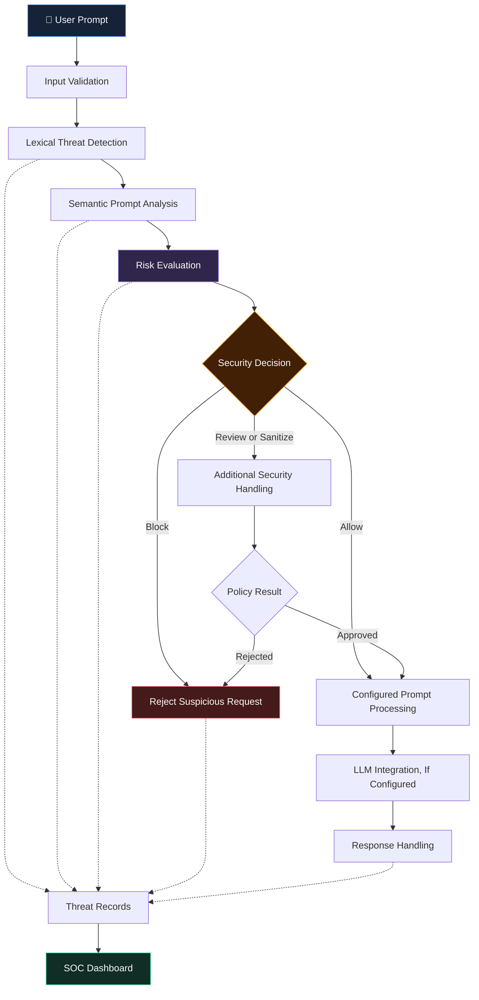

<div align="center">

# 🛡️ AEGIS AI

### ADAPTIVE SEMANTIC AI FIREWALL

**An Adaptive Self-Healing Semantic AI Firewall Framework for Large Language Models**

*Detect Suspicious Inputs · Analyze Threats · Strengthen AI Security*

<br>

[](https://www.python.org/)
[](https://streamlit.io/)
[](https://fastapi.tiangolo.com/)
[](https://github.com/mohamedrizwan4518)

<br>


<br>

**A TEAM PROJECT BY HARIHARAN V.S., RASHIKA V., AND RUBINI T.**

<br>

[📸 Screenshots](#-inside-aegis-ai) •
[✨ Features](#-core-capabilities) •
[🏗️ Architecture](#️-system-architecture) •
[🚀 Installation](#-getting-started) •
[🧪 Testing](#-testing-and-validation) •
[👥 Team](#-meet-the-team)

</div>

---

# ◈ 01. Project Overview

## What is Aegis AI?

**Aegis AI** is a cybersecurity project that explores how an adaptive security layer can help protect applications powered by Large Language Models (LLMs).

LLMs are increasingly used in conversational assistants, intelligent applications, and automated workflows. However, these systems can be exposed to prompt injection, jailbreak attempts, system-prompt extraction, role manipulation, and other adversarial inputs.

Aegis AI explores a layered approach to inspecting incoming prompts, identifying potentially suspicious patterns, evaluating risks, and applying configured security decisions.

The framework brings together lexical detection, semantic analysis, prompt sanitization, threat memory, and a Security Operations Center (SOC) dashboard.

### 🎯 Our Mission

> To explore practical, intelligent, and adaptive approaches to identifying prompt-based threats and strengthening the security of LLM-powered applications.

### 🔍 Project Objectives

- Detect potentially malicious prompts using configured security rules.
- Explore semantic techniques for identifying suspicious text patterns.
- Identify prompt injection, jailbreak, and system-prompt extraction attempts.
- Apply risk-based decisions to incoming prompts.
- Maintain records of detected threats for further analysis.
- Explore adaptive threat memory for recognizing recurring patterns.
- Provide a dashboard for visualizing security activity.
- Investigate multilingual prompt-security scenarios involving English, Tamil, and Tanglish.

> **Project scope:** Aegis AI is a development and research prototype. Its detection effectiveness depends on the implemented algorithms, configuration, and evaluation data. It has not been established as a complete production-grade security solution.

---

# 📸 02. Inside Aegis AI

The following screenshots showcase the application's interface and selected workflows.

<table>
<tr>
<td width="50%" align="center">

### 🖥️ Security Operations Center


**Security Dashboard**

Monitor application security information and explore available incident-management features.

</td>
<td width="50%" align="center">

### 🔬 Security Testing Lab


**Interactive Testing Interface**

Explore prompt-inspection workflows and the security-processing pipeline.

</td>
</tr>

<tr>
<td width="50%" align="center">

### 🔐 Authentication Interface


**Authentication and Access**

View the application's login interface and role-oriented workflows.

</td>
<td width="50%" align="center">

### 💬 Conversational Interface


**Chat and Security Inspection**

Explore conversational interaction and available security telemetry.

</td>
</tr>
</table>

*Note: The screenshots demonstrate the application interface. Displayed metrics and individual detection outcomes should not be interpreted as independently verified security benchmarks.*

---

# ✨ 03. Core Capabilities

<table>
<tr>
<td width="50%" valign="top">

## 🔍 Lexical Threat Detection

Uses configured rules and patterns to inspect incoming prompts for suspicious content.

**Threat categories of interest:**

- Prompt injection
- Jailbreak attempts
- System-prompt extraction
- Role manipulation
- Safety-policy bypass attempts

</td>
<td width="50%" valign="top">

## 🧠 Semantic Prompt Analysis

Explores text-similarity techniques to identify potentially suspicious prompts that may use different wording from known examples.

**Key objectives:**

- Analyze text representations.
- Compare prompts with configured threat patterns.
- Support risk assessment.
- Investigate paraphrased attack scenarios.

</td>
</tr>

<tr>
<td width="50%" valign="top">

## 🧹 Prompt Sanitization

Provides a sanitization stage for supported security workflows.

**Intended purposes:**

- Inspect suspicious input.
- Apply configured text transformations.
- Support safer prompt processing.
- Integrate sanitization with security decisions.

</td>
<td width="50%" valign="top">

## 🔄 Adaptive Threat Memory

Maintains threat-related records to support the analysis of recurring suspicious patterns.

**Intended purposes:**

- Preserve threat observations.
- Support historical inspection.
- Identify recurring patterns.
- Explore adaptive detection workflows.

</td>
</tr>

<tr>
<td width="50%" valign="top">

## 📊 Security Operations Dashboard

Provides a visual interface for inspecting security information and administrative workflows.

**Areas of interest:**

- Security-event monitoring
- Threat-category summaries
- Incident information
- User-management workflows
- Threat analytics and reporting

</td>
<td width="50%" valign="top">

## 🌐 Multilingual Security Research

Explores prompt-security scenarios involving different languages and writing styles.

**Languages of interest:**

- English
- Tamil
- Tanglish

Language-specific performance requires separate evaluation using representative test examples.

</td>
</tr>
</table>

---

# 🏗️ 04. System Architecture

Aegis AI explores a layered security-processing workflow in which incoming prompts are inspected before reaching the configured language-model processing stage.



### 🛡️ Defense-in-Depth

<div align="center">

| Layer | Responsibility |
|---|---|
| Input validation | Inspect incoming prompt data. |
| Lexical detection | Match configured suspicious patterns. |
| Semantic analysis | Evaluate similarity to threat patterns. |
| Risk evaluation | Apply configured security decisions. |
| Sanitization | Transform input when supported by the policy. |
| Threat records | Preserve relevant security observations. |
| SOC dashboard | Present available security events and analytics. |

**Architecture note:** This diagram illustrates the conceptual design. Actual processing order, integrations, and enforcement behavior depend on the current implementation.

---

# 🧰 05. Technology Stack

<div align="center">

| Technology | Purpose |
|:---|:---|
| 🐍 Python | Core application and security logic |
| 🎨 Streamlit | User interface and dashboard |
| ⚡ FastAPI | Backend API, where configured |
| 🧠 Scikit-learn | Text-analysis techniques, where implemented |
| 📊 Pandas | Data processing, where implemented |
| 🗃️ JSON | Local data and application records |
| 🔧 Git | Version control |
| ☁️ GitHub | Source-code hosting |

</div>

Additional libraries and external integrations depend on the installed dependencies and application configuration.

---

# 📂 06. Project Structure

```text
Aegis-AI-Phase1-Version1/
│
├── .streamlit/
│   └── config.toml
│
├── assets/
│   └── screenshots/
│       ├── soc_dashboard_overview.png
│       ├── testing_lab_pipeline_full.png
│       ├── login_screen.png
│       └── user_chat_view.png
│
├── backend/
│   ├── attack_logger.py
│   ├── auth.py
│   ├── blacklist_manager.py
│   ├── dashboard_analytics.py
│   ├── llm_engine.py
│   ├── main.py
│   ├── runner.py
│   ├── threat_engine.py
│   ├── threat_intelligence.py
│   └── user_manager.py
│
├── data/
│
├── experiments/
│
├── frontend/
│   └── app.py
│
├── security/
│   ├── prompt_detector.py
│   ├── prompt_sanitizer.py
│   ├── semantic_detector.py
│   └── threat_memory.py
│
├── tests/
│   └── test_aegis.py
│
├── .env.example
├── .gitignore
├── LICENSE
├── README.md
├── requirements.txt
├── run.bat
├── run.ps1
└── streamlit_app.py
```

*This structure reflects the documented project layout. Verify file names against the current repository if the project has changed.*

---

# 🚀 07. Getting Started

Follow these steps to set up Aegis AI locally.

## Prerequisites

Before starting, make sure you have:

- Python installed and compatible with the project dependencies.
- Git installed.
- A terminal such as PowerShell or Command Prompt.
- A code editor such as Visual Studio Code.

## Step 1 — Clone the Repository

```bash
git clone https://github.com/mohamedrizwan4518/An-adaptive-self-healing-semantic-ai-firewall-framework-v1-phase-1-.git
```

Navigate to the project directory:

```bash
cd An-adaptive-self-healing-semantic-ai-firewall-framework-v1-phase-1-
```

## Step 2 — Create a Virtual Environment

```bash
python -m venv .venv
```

### Windows PowerShell

```powershell
.\.venv\Scripts\Activate.ps1
```

### Windows Command Prompt

```bat
.venv\Scripts\activate.bat
```

### Linux / macOS

```bash
source .venv/bin/activate
```

## Step 3 — Install Dependencies

```bash
python -m pip install --upgrade pip
pip install -r requirements.txt
```

## Step 4 — Configure Environment Variables

If the application requires environment variables, create a local `.env` file from the provided example.

### Windows PowerShell

```powershell
Copy-Item .env.example .env
```

### Linux / macOS

```bash
cp .env.example .env
```

Open `.env` and configure the values required by the application.

If an external LLM provider is configured, use the API-key variable expected by the application.

> 🔒 **Security reminder:** Never upload actual API keys, passwords, access tokens, or other secrets to a public repository.

## Step 5 — Launch the Application

### Windows PowerShell

If the startup script is configured for your environment:

```powershell
.\run.ps1
```

### Alternative: Run Streamlit Directly

```bash
streamlit run streamlit_app.py
```

When the application starts successfully, Streamlit typically displays a local address similar to:

```text
http://localhost:8501
```

Open that address in your browser.

The backend API and its documentation are available only if the backend starts successfully.

---

# 🧪 08. Testing and Validation

The repository includes a test module at:

```text
tests/test_aegis.py
```

Run the tests using:

```bash
python -m unittest tests.test_aegis -v
```

Review the terminal output to determine which tests pass or fail.

### Recommended Evaluation Metrics

| Metric | What It Measures |
|---|---|
| Precision | Proportion of flagged prompts that are malicious within the labeled evaluation set. |
| Recall | Proportion of malicious prompts successfully detected. |
| F1-score | Combined measure of precision and recall. |
| False-positive rate | Proportion of benign prompts incorrectly flagged. |
| Detection latency | Time taken to inspect a prompt. |
| Language-specific performance | Detection behavior across English, Tamil, and Tanglish. |

A meaningful security evaluation requires a documented dataset, defined test conditions, and reproducible results.

**No specific detection-accuracy figure is claimed here without verified experimental evidence.**

---

# 🔐 09. Security Considerations

Aegis AI is a prototype intended for development, experimentation, and demonstration.

It should not be treated as the sole security boundary for a production LLM application.

Before production deployment, review the following:

- Authentication and secure password handling.
- Server-side authorization for privileged operations.
- Direct and indirect prompt-injection defenses.
- API-key and secret management.
- Input validation and output handling.
- Rate limiting and abuse prevention.
- Audit logging and sensitive-data retention.
- Threat-memory integrity.
- Isolation of untrusted model outputs.
- Testing against realistic attack scenarios.

### Demo Credentials

If demonstration accounts are configured in the application, use them only in an isolated demo environment.

Do not expose working default administrator credentials or sensitive local data in a public deployment.

Verify authentication and authorization before allowing external access.

---

# ☁️ 10. Deployment

The repository includes the Streamlit entry point:

```text
streamlit_app.py
```

Streamlit Community Cloud may be an option for hosting the interface.

Before deployment:

1. Verify that the application runs locally.
2. Confirm dependency compatibility.
3. Configure secrets through the hosting platform.
4. Review backend startup requirements.
5. Check data persistence and file-system behavior.
6. Test authentication and access controls.
7. Verify the deployed application's behavior.

A successful local run does not guarantee that all backend processes, integrations, or persistence features will work in a hosted environment.

---

# 🗺️ 11. Future Roadmap

Aegis AI can be extended through additional research, implementation, and evaluation.

- [ ] Expand the labeled prompt-attack dataset.
- [ ] Evaluate precision, recall, and F1-score.
- [ ] Measure false-positive rates and detection latency.
- [ ] Improve Tamil and Tanglish evaluation coverage.
- [ ] Enhance explainability for security decisions.
- [ ] Add regression tests for known attack patterns.
- [ ] Strengthen authentication and authorization.
- [ ] Improve security-event reporting.
- [ ] Evaluate concurrent-request performance.
- [ ] Document threat models and known limitations.
- [ ] Validate deployment and storage requirements.

These items are proposed future improvements, not claims that the functionality is already implemented.

---

# 👥 12. Meet the Team

<div align="center">

## 🤝 TEAM AEGIS AI

**Three Members. One Collaborative Project. One Shared Vision.**

*Working together to explore safer and more secure LLM-powered applications.*

<br>

</div>

### 🎓 Team Members

| No. | Team Member |
|:---:|---|
| 01 | **HARIHARAN V.S.** |
| 02 | **RASHIKA V.** |
| 03 | **RUBINI T.** |

### 📌 Project Information

| Category | Details |
|---|---|
| Project Name | Aegis AI — Adaptive Semantic AI Firewall |
| Project Type | Team Project |
| Project Phase | Phase 1 |
| Version | 1.0 |
| Domain | Artificial Intelligence & Cybersecurity |
| Institution | Achariya College of Engineering and Technology |
| Location | Puducherry, India |

### 💡 Our Collaborative Approach

Aegis AI brings together collaborative problem-solving, software development, security experimentation, and documentation.

The team is exploring how layered detection, semantic analysis, and risk-based security decisions can contribute to the protection of applications powered by Large Language Models.

**Our shared objective is to learn, build, test, and improve through practical engineering.**

*Individual responsibilities can be added when the team's roles have been finalized.*

---

# 🔗 13. Project Repository

<div align="center">

### Explore Aegis AI on GitHub

[](https://github.com/mohamedrizwan4518/An-adaptive-self-healing-semantic-ai-firewall-framework-v1-phase-1-)

<br>

**Repository:** `An-adaptive-self-healing-semantic-ai-firewall-framework-v1-phase-1-`

</div>

---

# 📄 14. License

This repository includes a [`LICENSE`](LICENSE) file.

Refer to that file for the applicable license terms.

---

<div align="center">

# 🛡️ AEGIS AI

### Detect. Analyze. Defend. Adapt.

*Exploring a safer layer for LLM-powered applications.*

<br>

**TEAM AEGIS AI**

HARIHARAN V.S. · RASHIKA V. · RUBINI T.

<br>


</div>
