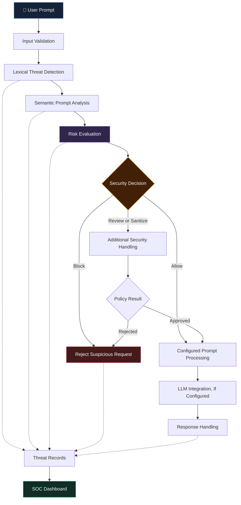

<div align="center">

# 🛡️ AEGIS AI

### ADAPTIVE SEMANTIC AI FIREWALL

**An Adaptive Self-Healing Semantic AI Firewall Framework for Large Language Models**

*Detect Suspicious Inputs · Analyze Threats · Strengthen AI Security*

<br>

[](https://www.python.org/)
[](https://streamlit.io/)
[](https://fastapi.tiangolo.com/)
[](https://github.com/mohamedrizwan4518)

<br>


<br>

**A TEAM PROJECT BY HARIHARAN V.S., RASHIKA V., AND RUBINI T.**

<br>

[📸 Screenshots](#-inside-aegis-ai) •
[✨ Features](#-core-capabilities) •
[🏗️ Architecture](#️-system-architecture) •
[🚀 Installation](#-getting-started) •
[🧪 Testing](#-testing-and-validation) •
[👥 Team](#-meet-the-team)

</div>

---

# ◈ 01. Project Overview

## What is Aegis AI?

**Aegis AI** is a cybersecurity project that explores how an adaptive security layer can help protect applications powered by Large Language Models (LLMs).

LLMs are increasingly used in conversational assistants, intelligent applications, and automated workflows. However, these systems can be exposed to prompt injection, jailbreak attempts, system-prompt extraction, role manipulation, and other adversarial inputs.

Aegis AI explores a layered approach to inspecting incoming prompts, identifying potentially suspicious patterns, evaluating risks, and applying configured security decisions.

The framework brings together lexical detection, semantic analysis, prompt sanitization, threat memory, and a Security Operations Center (SOC) dashboard.

### 🎯 Our Mission

> To explore practical, intelligent, and adaptive approaches to identifying prompt-based threats and strengthening the security of LLM-powered applications.

### 🔍 Project Objectives

- Detect potentially malicious prompts using configured security rules.
- Explore semantic techniques for identifying suspicious text patterns.
- Identify prompt injection, jailbreak, and system-prompt extraction attempts.
- Apply risk-based decisions to incoming prompts.
- Maintain records of detected threats for further analysis.
- Explore adaptive threat memory for recognizing recurring patterns.
- Provide a dashboard for visualizing security activity.
- Investigate multilingual prompt-security scenarios involving English, Tamil, and Tanglish.

> **Project scope:** Aegis AI is a development and research prototype. Its detection effectiveness depends on the implemented algorithms, configuration, and evaluation data. It has not been established as a complete production-grade security solution.

---

# 📸 02. Inside Aegis AI

The following screenshots showcase the application's interface and selected workflows.

<table>
<tr>
<td width="50%" align="center">

### 🖥️ Security Operations Center


**Security Dashboard**

Monitor application security information and explore available incident-management features.

</td>
<td width="50%" align="center">

### 🔬 Security Testing Lab


**Interactive Testing Interface**

Explore prompt-inspection workflows and the security-processing pipeline.

</td>
</tr>

<tr>
<td width="50%" align="center">

### 🔐 Authentication Interface


**Authentication and Access**

View the application's login interface and role-oriented workflows.

</td>
<td width="50%" align="center">

### 💬 Conversational Interface


**Chat and Security Inspection**

Explore conversational interaction and available security telemetry.

</td>
</tr>
</table>

*Note: The screenshots demonstrate the application interface. Displayed metrics and individual detection outcomes should not be interpreted as independently verified security benchmarks.*

---

# ✨ 03. Core Capabilities

<table>
<tr>
<td width="50%" valign="top">

## 🔍 Lexical Threat Detection

Uses configured rules and patterns to inspect incoming prompts for suspicious content.

**Threat categories of interest:**

- Prompt injection
- Jailbreak attempts
- System-prompt extraction
- Role manipulation
- Safety-policy bypass attempts

</td>
<td width="50%" valign="top">

## 🧠 Semantic Prompt Analysis

Explores text-similarity techniques to identify potentially suspicious prompts that may use different wording from known examples.

**Key objectives:**

- Analyze text representations.
- Compare prompts with configured threat patterns.
- Support risk assessment.
- Investigate paraphrased attack scenarios.

</td>
</tr>

<tr>
<td width="50%" valign="top">

## 🧹 Prompt Sanitization

Provides a sanitization stage for supported security workflows.

**Intended purposes:**

- Inspect suspicious input.
- Apply configured text transformations.
- Support safer prompt processing.
- Integrate sanitization with security decisions.

</td>
<td width="50%" valign="top">

## 🔄 Adaptive Threat Memory

Maintains threat-related records to support the analysis of recurring suspicious patterns.

**Intended purposes:**

- Preserve threat observations.
- Support historical inspection.
- Identify recurring patterns.
- Explore adaptive detection workflows.

</td>
</tr>

<tr>
<td width="50%" valign="top">

## 📊 Security Operations Dashboard

Provides a visual interface for inspecting security information and administrative workflows.

**Areas of interest:**

- Security-event monitoring
- Threat-category summaries
- Incident information
- User-management workflows
- Threat analytics and reporting

</td>
<td width="50%" valign="top">

## 🌐 Multilingual Security Research

Explores prompt-security scenarios involving different languages and writing styles.

**Languages of interest:**

- English
- Tamil
- Tanglish

Language-specific performance requires separate evaluation using representative test examples.

</td>
</tr>
</table>

---

# 🏗️ 04. System Architecture

Aegis AI explores a layered security-processing workflow in which incoming prompts are inspected before reaching the configured language-model processing stage.



### 🛡️ Defense-in-Depth

<div align="center">

| Layer | Responsibility |
|---|---|
| Input validation | Inspect incoming prompt data. |
| Lexical detection | Match configured suspicious patterns. |
| Semantic analysis | Evaluate similarity to threat patterns. |
| Risk evaluation | Apply configured security decisions. |
| Sanitization | Transform input when supported by the policy. |
| Threat records | Preserve relevant security observations. |
| SOC dashboard | Present available security events and analytics. |

**Architecture note:** This diagram illustrates the conceptual design. Actual processing order, integrations, and enforcement behavior depend on the current implementation.

---

# 🧰 05. Technology Stack

<div align="center">

| Technology | Purpose |
|:---|:---|
| 🐍 Python | Core application and security logic |
| 🎨 Streamlit | User interface and dashboard |
| ⚡ FastAPI | Backend API, where configured |
| 🧠 Scikit-learn | Text-analysis techniques, where implemented |
| 📊 Pandas | Data processing, where implemented |
| 🗃️ JSON | Local data and application records |
| 🔧 Git | Version control |
| ☁️ GitHub | Source-code hosting |

</div>

Additional libraries and external integrations depend on the installed dependencies and application configuration.

---

# 📂 06 · PROJECT STRUCTURE

<div align="center">

### A modular architecture for AI security

*Organized components. Clear responsibilities. Easier maintenance.*

</div>

```text
🛡️ Aegis-AI-Phase1-Version1/
│
├── 📁 .streamlit/
│   └── config.toml
│
├── 📁 assets/
│   └── 📁 screenshots/
│       ├── soc_dashboard_overview.png
│       ├── testing_lab_pipeline_full.png
│       ├── login_screen.png
│       └── user_chat_view.png
│
├── 📁 backend/
│   ├── attack_logger.py
│   ├── auth.py
│   ├── blacklist_manager.py
│   ├── dashboard_analytics.py
│   ├── llm_engine.py
│   ├── main.py
│   ├── runner.py
│   ├── threat_engine.py
│   ├── threat_intelligence.py
│   └── user_manager.py
│
├── 📁 data/
│   └── Application data and security records
│
├── 📁 experiments/
│   └── Experimental work and evaluation
│
├── 📁 frontend/
│   └── app.py
│
├── 📁 security/
│   ├── prompt_detector.py
│   ├── prompt_sanitizer.py
│   ├── semantic_detector.py
│   └── threat_memory.py
│
├── 📁 tests/
│   └── test_aegis.py
│
├── .env.example
├── .gitignore
├── LICENSE
├── README.md
├── requirements.txt
├── run.bat
├── run.ps1
└── streamlit_app.py
```

### 🧩 Component Directory

| Component | Responsibility |
|:---|:---|
| `.streamlit/` | Streamlit configuration |
| `assets/screenshots/` | Screenshots used in project documentation |
| `backend/` | API, authentication, logging, and management modules |
| `data/` | Application data and security records |
| `experiments/` | Experimental work and evaluation |
| `frontend/` | User interface and dashboard |
| `security/` | Prompt detection, sanitization, semantic analysis, and threat memory |
| `tests/` | Automated tests |
| `.env.example` | Example environment configuration |
| `.gitignore` | Git exclusion rules |
| `requirements.txt` | Python dependencies |
| `run.bat` / `run.ps1` | Windows startup scripts |
| `streamlit_app.py` | Streamlit application entry point |

> **Note:** Descriptive labels under `data/` and `experiments/` explain their intended purpose; they are not filenames. Keep the tree synchronized with the actual repository.

---

# 🚀 07 · GETTING STARTED

<div align="center">

### From repository to running application

**Clone → Configure → Install → Launch**

</div>

## Prerequisites

Before installing Aegis AI, make sure you have:

- Python compatible with the project dependencies
- Git
- Visual Studio Code or another code editor
- PowerShell, Command Prompt, or a compatible terminal

### Step 01 · Clone the repository

```bash
git clone https://github.com/mohamedrizwan4518/An-adaptive-self-healing-semantic-ai-firewall-framework-v1-phase-1-.git
```

Navigate to the cloned directory:

```bash
cd An-adaptive-self-healing-semantic-ai-firewall-framework-v1-phase-1-
```

### Step 02 · Create a virtual environment

```bash
python -m venv .venv
```

**Windows · PowerShell**

```powershell
.\.venv\Scripts\Activate.ps1
```

**Windows · Command Prompt**

```bat
.venv\Scripts\activate.bat
```

**Linux / macOS**

```bash
source .venv/bin/activate
```

### Step 03 · Install dependencies

```bash
python -m pip install --upgrade pip
pip install -r requirements.txt
```

### Step 04 · Configure environment variables

If required, create a local `.env` file using the supplied example.

**Windows · PowerShell**

```powershell
Copy-Item .env.example .env
```

**Linux / macOS**

```bash
cp .env.example .env
```

Open `.env` and configure the variables required by the application.

Use the exact environment-variable names expected by your implementation.

> 🔐 **Security first:** Never commit real API keys, passwords, access tokens, or production credentials to GitHub.

### Step 05 · Launch Aegis AI

**Windows · PowerShell**

```powershell
.\run.ps1
```

Alternatively, launch the Streamlit application directly:

```bash
streamlit run streamlit_app.py
```

When startup succeeds, open the local address displayed in your terminal. The default Streamlit address is typically:

```text
http://localhost:8501
```

**Expected result:** The application interface opens in your browser if startup completes successfully.

The backend API and its documentation are available only if the backend starts correctly.

---

# 🧪 08 · TESTING & VALIDATION

<div align="center">

### Test the implementation. Measure the results. Document the evidence.

</div>

The repository includes a test module:

```text
tests/test_aegis.py
```

Run the tests from the project root:

```bash
python -m unittest tests.test_aegis -v
```

Review the terminal output to identify passed tests, failures, and execution errors.

## Evaluation Metrics

| Metric | Purpose |
|:---|:---|
| **Precision** | Measures how many flagged prompts are malicious within the labeled test set |
| **Recall** | Measures how many malicious prompts are detected |
| **F1-score** | Combines precision and recall into one measure |
| **False-positive rate** | Measures benign prompts incorrectly flagged |
| **Detection latency** | Measures the time required to inspect a prompt |
| **Language-specific performance** | Evaluates behavior across English, Tamil, and Tanglish |

### Recommended validation process

1. Prepare a documented collection of benign and adversarial prompts.
2. Label the examples before evaluating the detector.
3. Run the same test cases against the configured implementation.
4. Record false positives, false negatives, and processing time.
5. Document the test environment and results.
6. Repeat the evaluation after changing detection rules or models.

> **Research integrity:** Do not report accuracy percentages or claim that every test passes unless the results have been measured and verified.

---

# 🔐 09 · SECURITY & RESPONSIBLE USE

Aegis AI is a prototype intended for development, experimentation, and demonstration.

It should not be treated as the sole security boundary for a production LLM application.

## Security checklist

| Security Area | What to Review |
|:---|:---|
| 🔑 Authentication | Password handling and session management |
| 🛂 Authorization | Server-side permission checks for privileged actions |
| 🧠 Prompt security | Direct and indirect prompt-injection defenses |
| 🔒 Secrets | API-key and credential protection |
| 🧹 Input handling | Validation of untrusted input |
| 📝 Audit logging | Integrity of records and protection of sensitive data |
| 🚦 Abuse prevention | Rate limits and request controls |
| 🗃️ Threat memory | Integrity and safe handling of stored records |
| 🧪 Validation | Testing against realistic attack scenarios |

### Demo credentials

If the application contains demonstration accounts, use them only in an isolated demo environment.

Before exposing the application publicly:

- Replace default administrator credentials.
- Verify authentication and authorization.
- Remove sensitive local data.
- Review API-key handling.
- Check whether administrative endpoints are adequately protected.

**A security dashboard alone does not guarantee that the underlying application is secure.**

---

# ☁️ 10 · DEPLOYMENT

The repository contains the Streamlit entry point:

```text
streamlit_app.py
```

Streamlit Community Cloud may be suitable for hosting the interface, depending on the application's requirements.

## Pre-deployment checklist

- [ ] Confirm that the application runs locally.
- [ ] Verify dependency compatibility.
- [ ] Configure secrets through the hosting platform.
- [ ] Check backend startup requirements.
- [ ] Review file-system and data-persistence behavior.
- [ ] Test authentication and access controls.
- [ ] Verify all screenshot and resource paths.
- [ ] Test the deployed application.

### Important deployment considerations

A successful local run does not guarantee that the application will work identically in a hosted environment.

Backend processes, external model integrations, persistent storage, and hosting restrictions must be evaluated separately.

Do not expose demonstration credentials or sensitive local data in a public deployment.

---

# 🗺️ 11 · PROJECT ROADMAP

<div align="center">

### Building toward a more thoroughly evaluated security framework

</div>

The following items are proposed enhancements for future development.

| Status | Planned Improvement |
|:---:|:---|
| ◻️ | Expand the labeled prompt-attack dataset |
| ◻️ | Evaluate precision, recall, and F1-score |
| ◻️ | Measure false-positive rates and detection latency |
| ◻️ | Improve Tamil and Tanglish evaluation coverage |
| ◻️ | Enhance explanations for security decisions |
| ◻️ | Add regression tests for known attack patterns |
| ◻️ | Strengthen authentication and authorization |
| ◻️ | Improve security-event reporting |
| ◻️ | Evaluate concurrent-request performance |
| ◻️ | Document threat models and limitations |
| ◻️ | Validate deployment and storage requirements |

**Roadmap note:** These are proposed improvements, not claims that the functionality is already implemented.

---

# 👥 12 · MEET THE TEAM

<div align="center">

## 🛡️ TEAM AEGIS AI

### Three Members · One Collaborative Project

*Working together to explore safer and more secure LLM-powered applications.*

<br>

</div>

## Team Members

<table>
<tr>
<td align="center" width="33%">

### 👨‍💻

**HARIHARAN V.S.**

Team Member

</td>
<td align="center" width="33%">

### 👩‍💻

**RASHIKA V.**

Team Member

</td>
<td align="center" width="33%">

### 👩‍💻

**RUBINI T.**

Team Member

</td>
</tr>
</table>

## Project Information

| Category | Details |
|:---|:---|
| **Project** | Aegis AI — Adaptive Semantic AI Firewall |
| **Project Type** | Team Project |
| **Phase** | Phase 1 |
| **Version** | 1.0 |
| **Domain** | Artificial Intelligence & Cybersecurity |
| **Institution** | Achariya College of Engineering and Technology |
| **Location** | Puducherry, India |

## Our Collaborative Approach

Aegis AI brings together collaborative problem-solving, software development, security experimentation, and documentation.

The team is exploring how layered detection, semantic analysis, and risk-based decisions can contribute to the protection of applications powered by Large Language Models.

**Our shared objective is to learn, build, test, and improve through practical engineering.**

*Individual responsibilities can be added when the team's roles have been finalized.*

---

# 🔗 13 · PROJECT REPOSITORY

<div align="center">

### Explore the source code

[](https://github.com/mohamedrizwan4518/An-adaptive-self-healing-semantic-ai-firewall-framework-v1-phase-1-)

<br>

**AEGIS AI · PHASE 1 · VERSION 1.0**

</div>

---

# 📄 14 · LICENSE

This repository contains a [`LICENSE`](LICENSE) file.

Refer to that file for the applicable license terms.

---

<div align="center">

# 🛡️ AEGIS AI

### DETECT · ANALYZE · DEFEND · ADAPT

*Exploring a safer layer for LLM-powered applications.*

<br>

**TEAM AEGIS AI**

HARIHARAN V.S. · RASHIKA V. · RUBINI T.

<br>


</div>


</div>
