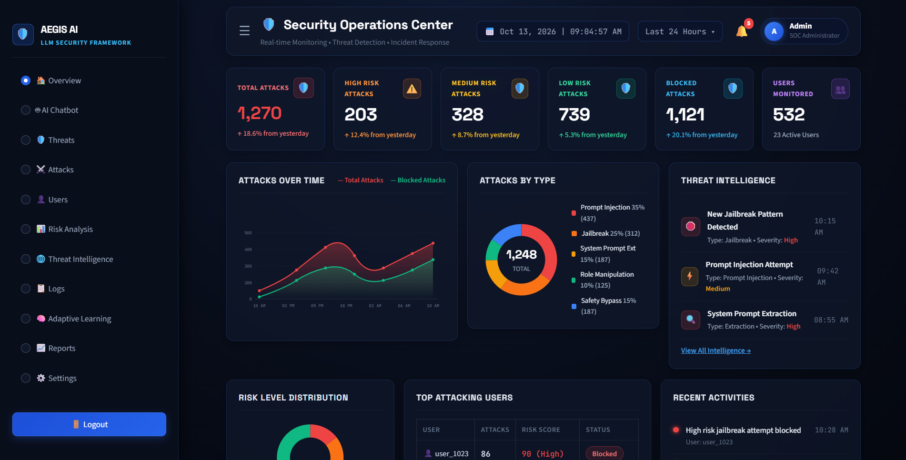
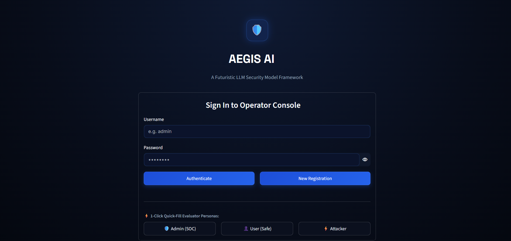

# 🛡️ Aegis AI — Adaptive Semantic AI Firewall

### An Adaptive Self-Healing Semantic AI Firewall Framework for Large Language Models

<p align="center">
  <strong>Detect. Analyze. Defend. Adapt.</strong>
  <br>
  A security-focused project exploring intelligent detection and mitigation of prompt-based attacks against Large Language Models (LLMs).
</p>

<p align="center">
  
  
  
  
  
  
</p>

---

## 📌 Overview

**Aegis AI** is a cybersecurity project designed to provide a protective layer between users and Large Language Models (LLMs).

The framework focuses on identifying potentially malicious prompts, evaluating security risks, and applying appropriate decisions before requests reach the language model.

It explores a combination of lexical pattern matching, semantic similarity analysis, prompt sanitization, threat memory, and security monitoring through a dashboard.

The project also explores multilingual prompt analysis, including English, Tamil, and Tanglish.

### 🎯 Project Objectives

- Detect prompt injection and jailbreak attempts.
- Identify potential system-prompt extraction and role-manipulation attacks.
- Analyze suspicious prompts using lexical and semantic techniques.
- Apply risk-based decisions to incoming prompts.
- Maintain a record of detected threats.
- Explore adaptive threat memory for recognizing recurring attack patterns.
- Provide a dashboard for monitoring security events and user activity.

> **Project scope:** Aegis AI is a prototype intended for development, demonstration, and evaluation. Its detection results depend on the implemented rules, models, configuration, and test data. It should not be considered a complete replacement for production security controls.

---

## 📸 Application Screenshots

The following screenshots demonstrate the application's interface and selected security workflows.

| SOC Dashboard | Security Testing Lab |
|:---:|:---:|
|  |  |
| *Security monitoring interface* | *Prompt inspection and pipeline visualization* |

| Authentication Interface | Conversational Inspection Interface |
|:---:|:---:|
|  |  |
| *Login and role selection* | *Conversational interface with security telemetry* |

**Note:** Screenshots are demonstrations of the application's interface. Displayed metrics and simulated attack outcomes should not be interpreted as independently validated security benchmarks.

---

## ✨ Key Features

### 1. 🔍 Lexical Threat Detection

Uses configured patterns and rules to identify suspicious prompt content.

Potential detection categories include:

- Prompt injection
- Jailbreak attempts
- System-prompt extraction
- Role manipulation
- Safety-policy bypass attempts

Detection coverage depends on the rules implemented in the current version.

### 2. 🧠 Semantic Prompt Analysis

Uses text-based similarity techniques to evaluate suspicious prompts against configured threat patterns.

The intended goal is to recognize potentially malicious wording even when it differs from known examples.

Semantic detection can produce false positives and false negatives. Its effectiveness must be evaluated using a representative test dataset.

### 3. 🧹 Prompt Sanitization

Explores prompt sanitization as an additional security step.

Depending on the implemented decision policy, the system can inspect a prompt and apply an appropriate action, such as allowing, blocking, or attempting to sanitize it.

Sanitization should not be treated as a guarantee that all malicious intent has been removed.

### 4. 🔄 Adaptive Threat Memory

Maintains threat-related records to support recognition and analysis of recurring suspicious patterns.

The framework explores how previously observed threats can contribute to future detection decisions.

Persistent storage of a threat record does not, by itself, mean the detection model has been retrained or improved automatically.

### 5. 📊 Security Operations Dashboard

The dashboard provides an interface for examining security activity and application status.

Depending on the enabled modules, dashboard functions include:

- Security event monitoring
- Threat-category summaries
- Risk and incident information
- User and access-management controls
- Threat history and analytics
- Security record exports

### 6. 🧪 Interactive Testing Environment

Provides an environment for experimenting with prompts and examining their security outcomes.

Suggested test categories include:

- Benign prompts
- Direct prompt injection
- Jailbreak attempts
- System-prompt extraction
- Role manipulation
- Multilingual prompts
- Tamil and Tanglish examples

The results should be recorded and evaluated before drawing conclusions about detection accuracy.

### 7. 🔐 Authentication and Access Control

The application includes an authentication interface and role-oriented workflows.

For production use, authentication, password storage, authorization, session management, and administrative actions require a dedicated security review.

---

## 🏗️ System Architecture

The conceptual processing workflow is:

```text
                 ┌──────────────────────┐
                 │     User Prompt      │
                 └──────────┬───────────┘
                            │
                            ▼
                 ┌──────────────────────┐
                 │  Input Validation    │
                 └──────────┬───────────┘
                            │
                            ▼
                 ┌──────────────────────┐
                 │  Lexical Detection   │
                 └──────────┬───────────┘
                            │
                            ▼
                 ┌──────────────────────┐
                 │ Semantic Analysis    │
                 └──────────┬───────────┘
                            │
                            ▼
                 ┌──────────────────────┐
                 │ Risk / Decision Gate │
                 └──────────┬───────────┘
                            │
                 ┌──────────┴───────────┐
                 ▼                      ▼
        ┌────────────────┐     ┌────────────────┐
        │ Allow / Process│     │ Block / Review │
        └────────┬───────┘     └────────────────┘
                 │
                 ▼
        ┌────────────────┐
        │ Sanitization   │
        │ if configured  │
        └────────┬───────┘
                 │
                 ▼
        ┌────────────────┐
        │ Model Response │
        └────────┬───────┘
                 │
                 ▼
        ┌────────────────┐
        │ Event Logging  │
        └────────────────┘
```

This diagram illustrates the intended security workflow. The actual execution order and enforcement behavior depend on the current implementation.

---

## 🛠️ Technology Stack

| Technology | Purpose |
|---|---|
| Python | Core application and security logic |
| Streamlit | User interface and dashboard |
| FastAPI | Backend API, where configured |
| Scikit-learn | Text processing and similarity techniques, where implemented |
| Pandas | Data processing, where implemented |
| JSON | Local application data and records |
| Git and GitHub | Version control and source-code hosting |

Additional libraries and external model providers may be used depending on the configuration in `requirements.txt`.

---

## 📂 Project Structure

```text
Aegis-AI-Phase1-Version1/
│
├── .streamlit/
│   └── config.toml
│
├── assets/
│   └── screenshots/
│       ├── soc_dashboard_overview.png
│       ├── testing_lab_pipeline_full.png
│       ├── login_screen.png
│       └── user_chat_view.png
│
├── backend/
│   ├── attack_logger.py
│   ├── auth.py
│   ├── blacklist_manager.py
│   ├── dashboard_analytics.py
│   ├── llm_engine.py
│   ├── main.py
│   ├── runner.py
│   ├── threat_engine.py
│   ├── threat_intelligence.py
│   └── user_manager.py
│
├── data/
│
├── experiments/
│
├── frontend/
│   └── app.py
│
├── security/
│   ├── prompt_detector.py
│   ├── prompt_sanitizer.py
│   ├── semantic_detector.py
│   └── threat_memory.py
│
├── tests/
│   └── test_aegis.py
│
├── .env.example
├── .gitignore
├── LICENSE
├── README.md
├── requirements.txt
├── run.bat
├── run.ps1
└── streamlit_app.py
```

The directory listing is based on the project's documented structure. Check the repository if any file names or modules have changed.

---

## 🚀 Getting Started

### Prerequisites

Install the following before running the project:

- Python compatible with the installed dependencies
- Git
- Visual Studio Code or another code editor
- A terminal such as PowerShell or Command Prompt

### Step 1: Clone the Repository

```bash
git clone https://github.com/mohamedrizwan4518/An-adaptive-self-healing-semantic-ai-firewall-framework-v1-phase-1-.git
```

Navigate into the project:

```bash
cd An-adaptive-self-healing-semantic-ai-firewall-framework-v1-phase-1-
```

### Step 2: Create a Virtual Environment

```bash
python -m venv .venv
```

Activate it on Windows PowerShell:

```powershell
.\.venv\Scripts\Activate.ps1
```

On Windows Command Prompt:

```bat
.venv\Scripts\activate.bat
```

On Linux or macOS:

```bash
source .venv/bin/activate
```

### Step 3: Install Dependencies

```bash
python -m pip install --upgrade pip
pip install -r requirements.txt
```

### Step 4: Configure Environment Variables

If the project uses environment variables, create a local `.env` file from the example:

**Windows PowerShell:**

```powershell
Copy-Item .env.example .env
```

**Linux or macOS:**

```bash
cp .env.example .env
```

Open `.env` and configure the required values according to the application's implementation.

If an external LLM provider is configured, add its API key using the variable name expected by the code.

**Never commit real API keys, passwords, or other secrets to GitHub.**

### Step 5: Launch the Application

For Windows PowerShell, the project provides a startup script:

```powershell
.\run.ps1
```

Alternatively, launch the Streamlit entry point directly:

```bash
streamlit run streamlit_app.py
```

If startup succeeds, Streamlit normally displays a local address similar to:

```text
http://localhost:8501
```

Open the address in your browser.

**Note:** The availability of the backend API and its documentation depends on whether the backend starts successfully.

---

## 🧪 Testing

The repository includes a test file at:

```text
tests/test_aegis.py
```

To execute the test suite, use:

```bash
python -m unittest tests.test_aegis -v
```

Review the terminal output to determine which tests passed, failed, or encountered errors.

Do not assume that every test passes without running the suite in your environment.

### Suggested Evaluation Areas

| Area | What to Evaluate |
|---|---|
| Detection | Correct identification of known attack examples |
| False positives | Benign prompts incorrectly classified as malicious |
| False negatives | Malicious prompts incorrectly classified as benign |
| Multilingual support | Detection behavior for English, Tamil, and Tanglish |
| Authentication | Correct handling of valid and invalid credentials |
| Access control | Whether restricted actions are properly enforced |
| Sanitization | Whether transformed prompts remain safe and useful |
| Threat memory | Whether records persist and are handled correctly |
| Performance | Processing time and resource consumption |

For a research-quality evaluation, use a documented dataset, fixed test conditions, reproducible measurements, and a clearly defined evaluation methodology.

---

## 🔐 Security Considerations

Aegis AI is an experimental project. It should not be deployed as the sole security boundary for a production LLM application.

Before production deployment, consider:

- Secure password hashing and authentication.
- Server-side authorization for every privileged action.
- Protection against direct and indirect prompt injection.
- Validation of external model responses.
- Secure handling of API keys and environment variables.
- Input validation and output handling.
- Rate limiting and abuse prevention.
- Audit-log integrity and sensitive-data minimization.
- Isolation of untrusted model output.
- Security testing against realistic attack scenarios.

### Demo Credentials

If the application provides demonstration accounts, use only the credentials configured in the source code and intended for local testing.

Avoid publishing working administrator credentials for a publicly accessible deployment. Replace default credentials and disable demonstration accounts before exposing the application to external users.

---

## ☁️ Deployment

The repository contains a Streamlit entry point named:

```text
streamlit_app.py
```

A possible hosting option is Streamlit Community Cloud.

Before deployment:

1. Confirm the application runs locally.
2. Confirm all required dependencies are declared in `requirements.txt`.
3. Review file-system paths and data persistence requirements.
4. Configure secrets through the hosting platform's secret-management interface.
5. Verify whether the backend startup mechanism is compatible with the hosting environment.
6. Test authentication, session handling, and application behavior after deployment.

Deployment is not guaranteed simply because the repository contains a Streamlit entry point. Backend processes, persistent storage, API configuration, and hosting restrictions must be verified.

---

## 🗺️ Future Roadmap

Potential future improvements include:

- [ ] Expand the prompt-attack evaluation dataset.
- [ ] Add reproducible detection benchmarks.
- [ ] Evaluate precision, recall, F1-score, and false-positive rate.
- [ ] Improve Tamil and Tanglish detection.
- [ ] Add structured security-event reporting.
- [ ] Improve explainability of detection decisions.
- [ ] Strengthen authentication and authorization.
- [ ] Add automated regression tests.
- [ ] Evaluate performance under concurrent requests.
- [ ] Improve deployment configuration and operational monitoring.
- [ ] Document limitations and threat-model assumptions.

These items are proposed enhancements, not claims that the functionality is already implemented.

---

## 🎓 Project Information

**Project:** Aegis AI — Adaptive Semantic AI Firewall  
**Phase:** Phase 1  
**Version:** 1.0  
**Domain:** Artificial Intelligence, Application Security, and LLM Security  
**Interface:** Streamlit  
**Backend:** Python / FastAPI, where configured  

The project explores how layered detection, risk-based decisions, and threat monitoring can contribute to protecting applications that use Large Language Models.

---

## 👨‍💻 Developer

**Mohamed Rizwan R**

B.Tech — Artificial Intelligence and Data Science  
Achariya College of Engineering and Technology, Puducherry

**GitHub:** [@mohamedrizwan4518](https://github.com/mohamedrizwan4518)

**Project Repository:** [Aegis AI — Phase 1, Version 1](https://github.com/mohamedrizwan4518/An-adaptive-self-healing-semantic-ai-firewall-framework-v1-phase-1-)

---

## 📄 License

This project includes a `LICENSE` file in the repository. Refer to that file for the applicable license terms.

---

<p align="center">
  <strong>Built to explore safer and more responsible LLM applications.</strong>
  <br>
  Detect threats. Evaluate risks. Strengthen defenses.
</p>
